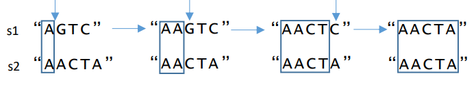
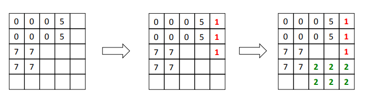

# Algorithms-And-Complexity-Practices
These are my solutions to the practices of Algorithms and complexity subject written in Java. Each practice has a set of tests of correctness of the developed solutions and the teachers also took into account the execution time for each practice for the final grade (the optimization of our solutions).

<p align="center">
  
  
</p>

## Index
- **P0 Sorting Algorithms:** Sorting algorithms and their complexity, comparison in execution time.
- **P1 Divide and Conquer:** Divide and conquer based problem solution.

    The goal of this practice is to perform the sum of all of the positive elements of a circularly sorted vector. For the first part it has to be developed with a worst case algorithmic complexity of O(N), and for the second part, it has to be developed with a worst case complexity of O(LogN).

    A circularly sorted vector is defined as follows: $\quad v[N-1] \leq v[0] \quad \land \quad \exists k \quad with \quad 0 < k < N \quad$
$\quad \mid \quad \forall i \neq k \quad v[i] \leq v[i+1]$

- **P2 Backtracking:** Backtracking and Branch and Bound for problem optimization.

    In order to succesfully solve this problem, it has to be applied bounding in order to discard candidates and optimize the search. The goal is to find the minimum number of mutations that the string1 requires to transform into string2. The available operations are maintaining, changing, removing or inserting characters ('A', 'G', 'C', 'T').

    In the following example, the minimum number of mutations in order to transform the string s1 into string s2 is 3:

     

- **P3 Greedy:** Greedy algorithm for candidate selection and feasible solutions.

    Implement a greedy algorithm that maximizes the filling of an inventory with a set of objects of different sizes (width x height) and different values. It is not needed the optimal solution but an approximation.

    For example, if we first have in our inventory an object with id 0 with dimensions 3x2, an object with id 5 (1x2) and an object with id 7 (2x2) (first image), and we add an object with id 1 (1x3) (second image), and finally add an object with id 2 (3x2), we obtain a final inventory as shown in the last image:

    

- **P4 Dynamic Programming:** Dynamic programming problem, text processor.

    In a text processor there is a number of N digits (numbered from 0 to N-1) written, and the cursor is at position $k \in \lbrace 0, 1, \dots, N \rbrace$, just before the digit k (if $k = N$ the cursor is at the end of the number). The available keys are: left arrow (moves the cursor one position to the left), right arrow (moves it one position to the right), Supr (deletes the digit immediately to the right of the cursor) and the digits 0 to 9 (insert a digit immediately to the left of the cursor). The goal is to find the minimum number of key presses needed to transform the written number into a palindrome. It has to be developed with a complexity of at most $O(N^2)$ in time and $O(N)$ in memory.

    For example, the minimum number of key presses to turn `1 3 | 4 5 6 7 5 4 3 2 1` into a palindrome is 6:

    ```
    <-      : 1 | 3 4 5 6 7 5 4 3 2 1
    2       : 1 2 | 3 4 5 6 7 5 4 3 2 1
    ->      : 1 2 3 | 4 5 6 7 5 4 3 2 1
    ->      : 1 2 3 4 | 5 6 7 5 4 3 2 1
    ->      : 1 2 3 4 5 | 6 7 5 4 3 2 1
    Supr    : 1 2 3 4 5 | 7 5 4 3 2 1
    ```

    The cursor sweeps a window $[L, R]$ that contains k, either going left first and then right, or right first and then left. Each tour gives every kept, deleted or inserted digit a fixed cost. The palindrome is then built from the outside in, like the classic minimum edits to palindrome problem, keeping as state whether each end is inside the window. Only two rows of the table are kept, which gives $O(N^2)$ time and $O(N)$ memory.

## License
[GPL-3.0](https://www.gnu.org/licenses/gpl-3.0.html)
